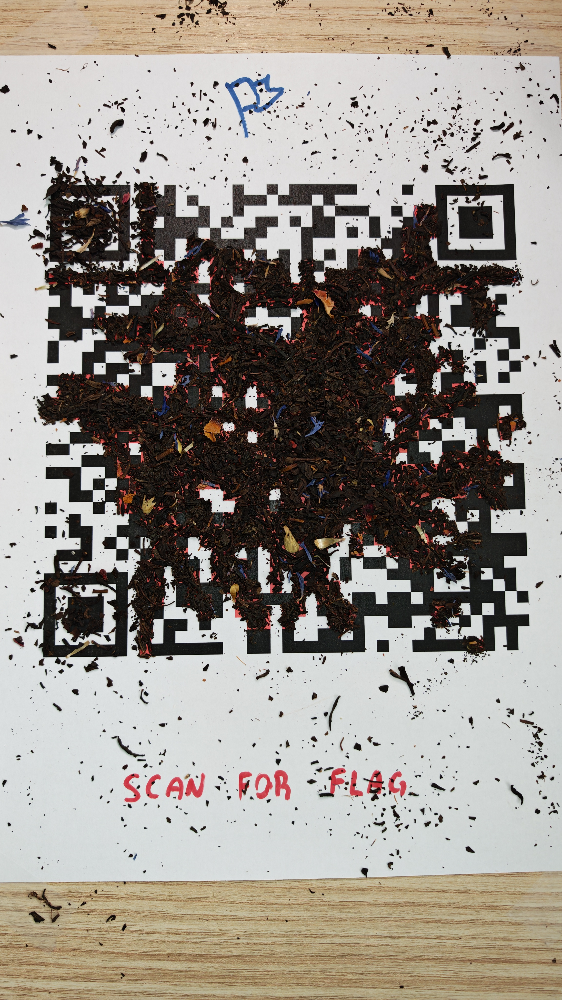
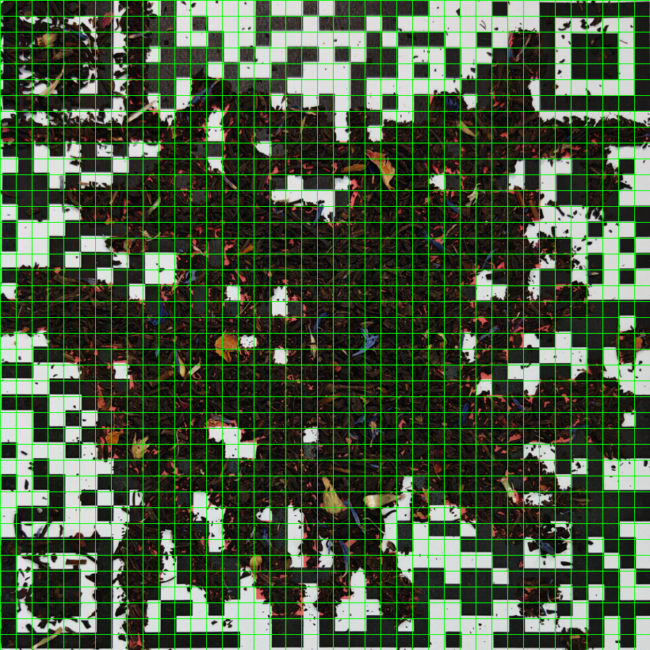
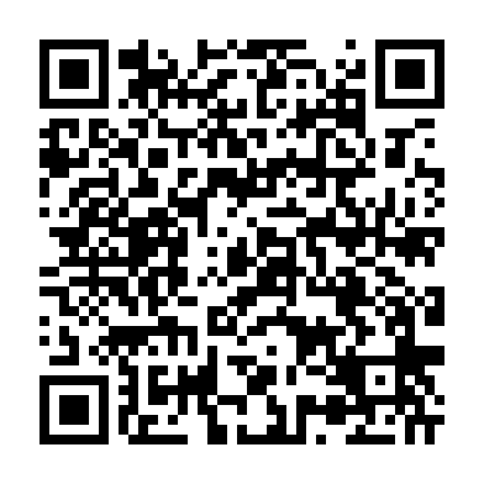

# Spill the Tea

## Challenge

Authors: **ipaljak, laragrr**. Statement category: **Miscellaneous**; recorded score: **500**.

> Oh no! Our recent hire spilled some tea over flag. Hope you can still read it...

The artifact is [flag.jpg](https://platform.ctf.fortid.com/uploads/3dd091c6a6e2a0c4a53c650f6d931ad0a693fbc2d6e200a315d0440e70ef6803/flag.jpg), a **2304 × 4096** JPEG of **4,765,346 bytes**. Tea leaves cover most of the data area of a QR code printed on paper.



SHA-256 of the original file and the copy in this repository:

```text
3dd091c6a6e2a0c4a53c650f6d931ad0a693fbc2d6e200a315d0440e70ef6803
```

## Analysis

OpenCV cannot decode the original image directly. The finder patterns and many isolated patches of paper remain visible, so individual exposed bits can be measured. A global dark/light threshold is insufficient: dark tea leaves would turn covered white modules into incorrect black bits.

The grid has **41 × 41 modules**, making it QR version 6 because `41 = 17 + 4 × 6`. A homography maps the QR region onto a square. The source pixel coordinates, ordered top left, top right, bottom right, bottom left, are:

```text
(198, 758), (2107, 750), (2169, 2670), (173, 2698)
```

Each rectified module occupies **40 × 40 pixels**. The inspection grid below is resized for display:



Two measurement passes yield **699 initial modules** and **120 additional black modules**:

- White paper has high average brightness, low standard deviation, and small differences between color channels.
- Black ink is relatively neutral and uniform. The additional pass measures a Gaussian-blurred image to reduce the effect of printed ink texture.
- Unreliable cells remain unknown. Cell `(row=19, col=36)`, using zero-based indices, is discarded because its dark sampled patch lies on a tea fragment rather than reliably measuring the paper.

The exact thresholds are in `measure()` below. The coordinates and thresholds are specific to the original file checked by its hash; this is not a general QR reader.

## Reed–Solomon reconstruction

The parameters used for recovery are **version 6, ECC Q, mask 3**. This configuration has four Reed–Solomon blocks, each with **19 data bytes + 24 parity bytes = 43 bytes**. There are **76 data bytes = 608 unknown bits**, and **172 codewords = 1376 bits** after adding parity and interleaving the blocks.

First reserve the finder, separator, timing, alignment, and format modules. Traverse the remaining cells using the QR two-column zigzag order, then remove the mask with `qrcode.util.mask_func(3)`. Structural modules must not be treated as payload bits.

Reed–Solomon is linear over GF(256). Expressing each byte as eight bits makes the encoder linear over **GF(2)** as well. Let `x` be the 608-bit data vector. Construct its encoding matrix by encoding each of the 608 basis vectors, with one input bit set, and interleaving data/parity in QR order. Each observed codeword bit contributes an equation:

```text
encoder_row[i] · x = observed_module XOR mask(row, col)
```

Gaussian elimination using XOR gives **rank 600/608**, leaving **8 free variables**. Enumerate the `2^8 = 256` assignments, parse a byte-mode segment (`0100`) and its 8-bit length, and retain payloads consisting entirely of printable ASCII (`32..126`). Exactly one candidate remains under these conditions. The reproducer does not hardcode the flag, the `FortID{` prefix, or the English sentence.

One detail matters: the last five data bytes are `d0 00 ec 11 ec`; nibble `d` belongs to the closing `}`. An extra `00` byte precedes the `ec 11 ec` padding sequence. Forcing padding `ec 11 ec 11` immediately after the terminator/alignment conflicts with visible modules. The code therefore solves all data bits, including padding, instead of assuming a padding layout.

## Reproduction code

Save the following block as `solve.py`. Run it from the event directory with the included original image:

```powershell
python -m pip install numpy Pillow opencv-python-headless qrcode reedsolo zxing-cpp
python solve.py "images/spill-the-tea-original.jpg"
```

```python
import hashlib
import sys
from pathlib import Path

import cv2
import numpy as np
import qrcode
import reedsolo
import zxingcpp
from PIL import Image
from qrcode import base, util

N, SCALE, K = 41, 40, 608
ECC, MASK = qrcode.constants.ERROR_CORRECT_Q, 3


def template():
    qr = qrcode.QRCode(version=6, error_correction=ECC, mask_pattern=MASK)
    qr.modules_count = N
    qr.modules = [[None] * N for _ in range(N)]
    for r, c in [(0, 0), (N - 7, 0), (0, N - 7)]:
        qr.setup_position_probe_pattern(r, c)
    qr.setup_position_adjust_pattern()
    qr.setup_timing_pattern()
    qr.setup_type_info(False, MASK)
    return qr


def data_positions():
    qr = template()
    positions, row, step = [], N - 1, -1
    for col in range(N - 1, 0, -2):
        if col <= 6:
            col -= 1
        while True:
            for c in (col, col - 1):
                if qr.modules[row][c] is None:
                    positions.append((row, c))
            row += step
            if row < 0 or row >= N:
                row -= step
                step = -step
                break
    return positions[:172 * 8]


def measure(path):
    image = cv2.imread(str(path))
    corners = np.float32([[198, 758], [2107, 750], [2169, 2670], [173, 2698]])
    target = np.float32([[0, 0], [N*SCALE, 0], [N*SCALE, N*SCALE], [0, N*SCALE]])
    h = cv2.getPerspectiveTransform(corners, target)
    image = cv2.warpPerspective(image, h, (N*SCALE, N*SCALE))
    a = cv2.cvtColor(image, cv2.COLOR_BGR2RGB).astype(np.float32)
    gray = a.mean(2)
    mean7 = cv2.blur(gray, (7, 7))
    std7 = np.sqrt(np.maximum(0, cv2.blur(gray*gray, (7, 7)) - mean7*mean7))
    chroma = a.max(2) - a.min(2)
    white = (mean7 > 160) & (std7 < 12) & (cv2.blur(chroma, (7, 7)) < 20)
    mean15 = cv2.blur(gray, (15, 15))
    std15 = np.sqrt(np.maximum(0, cv2.blur(gray*gray, (15, 15)) - mean15*mean15))
    ch15 = cv2.blur(chroma, (15, 15))
    black = (mean7 < 100) & (std15 < 3.5) & (ch15 < 7)
    bits = np.full((N, N), -1, dtype=int)
    for r in range(N):
        for c in range(N):
            sl = (slice(r*SCALE + 7, r*SCALE + 33), slice(c*SCALE + 7, c*SCALE + 33))
            w, b = int(white[sl].sum()), int(black[sl].sum())
            if max(w, b) > 25 and min(w, b) < max(w, b)*0.1:
                bits[r, c] = int(b > w)
    initial = int((bits >= 0).sum())
    smoothed = cv2.GaussianBlur(gray, (7, 7), 2)
    smooth_mean = cv2.blur(smoothed, (15, 15))
    smooth_std = np.sqrt(np.maximum(0, cv2.blur(smoothed*smoothed, (15, 15)) - smooth_mean**2))
    ink = (mean15 < 100) & (mean15 > 18) & (ch15 < mean15*0.18) & (smooth_std < 5)
    added = 0
    for r in range(N):
        for c in range(N):
            sl = (slice(r*SCALE + 12, r*SCALE + 28), slice(c*SCALE + 12, c*SCALE + 28))
            if bits[r, c] < 0 and ink[sl].sum() > 50:
                bits[r, c] = 1
                added += 1
    # This patch is a tea fragment, not a reliable measurement of the paper.
    bits[19, 36] = -1
    print(f"initial={initial}, additional={added}")
    return bits


def encode(payload):
    blocks = base.rs_blocks(6, ECC)
    dc, ec, offset = [], [], 0
    codec = reedsolo.RSCodec(24)
    for block in blocks:
        part = payload[offset:offset + block.data_count]
        offset += block.data_count
        encoded = codec.encode(part)
        dc.append(part)
        ec.append(encoded[block.data_count:])
    return [v[j] for j in range(19) for v in dc] + [v[j] for j in range(24) for v in ec]


def generator():
    rows = [0] * (172*8)
    for i in range(K):
        payload = [0] * (K//8)
        payload[i//8] = 1 << (7 - i%8)
        for j, byte in enumerate(encode(payload)):
            for b in range(8):
                if byte >> (7 - b) & 1:
                    rows[j*8 + b] |= 1 << i
    return rows


def affine(equations):
    pivots = {}
    for coeff, rhs in equations:
        while coeff:
            p = coeff.bit_length() - 1
            if p not in pivots:
                pivots[p] = (coeff, rhs)
                break
            other, value = pivots[p]
            coeff ^= other
            rhs ^= value
        if not coeff and rhs:
            raise ValueError("Inconsistent image observations")
    free = [i for i in range(K) if i not in pivots]
    expressions = {i: 1 << j for j, i in enumerate(free)}
    constants = {i: 0 for i in free}
    for p, (coeff, rhs) in sorted(pivots.items()):
        expression, value = 0, rhs
        for i in range(p):
            if coeff >> i & 1:
                expression ^= expressions[i]
                value ^= constants[i]
        expressions[p], constants[p] = expression, value
    print(f"rank={len(pivots)}/{K}, free={len(free)}")
    return free, expressions, constants


def main():
    path = Path(sys.argv[1])
    digest = hashlib.sha256(path.read_bytes()).hexdigest()
    assert digest == '3dd091c6a6e2a0c4a53c650f6d931ad0a693fbc2d6e200a315d0440e70ef6803'
    bits, positions, rows = measure(path), data_positions(), generator()
    mask = util.mask_func(MASK)
    equations = [(rows[i], int(bits[r, c]) ^ int(mask(r, c)))
                 for i, (r, c) in enumerate(positions) if bits[r, c] >= 0]
    free, expressions, constants = affine(equations)
    candidates = []
    for choice in range(1 << len(free)):
        values = [constants[i] ^ ((expressions[i] & choice).bit_count() & 1) for i in range(K)]
        payload = bytes(sum(values[j*8 + b] << (7-b) for b in range(8)) for j in range(K//8))
        raw = int.from_bytes(payload, 'big')
        mode, length = raw >> (K-4), (raw >> (K-12)) & 255
        if mode != 4 or length > (K-12)//8:
            continue
        text = bytes((raw >> (K-12-8*(j+1))) & 255 for j in range(length))
        if all(32 <= ch < 127 for ch in text):
            candidates.append((payload, text))
    print(f"printable candidates={len(candidates)}")
    assert len(candidates) == 1
    payload, text = candidates[0]
    print(text.decode('ascii'))
    print(f"tail={payload[-5:].hex()}")
    qr = template()
    qr.map_data(encode(list(payload)), MASK)
    pixels = np.pad(255*(1-np.array(qr.modules, dtype=np.uint8)), 4, constant_values=255)
    image = Image.fromarray(pixels).resize((980, 980), Image.Resampling.NEAREST)
    image.save('recovered_qr.png')
    zx = zxingcpp.read_barcode(image).text
    cv = cv2.QRCodeDetector().detectAndDecode(np.asarray(image))[0]
    assert zx == cv == text.decode('ascii')
    print('ZXing/OpenCV: match')


if __name__ == '__main__':
    main()
```

Output:

```text
initial=699, additional=120
rank=600/608, free=8
printable candidates=1
FortID{1_Sw3ar_70_Sp1ll_7h3_T3a_Th3_Wh0l3_Te3_4nd_N0thin6_Bu7_7h3_T34}
tail=d000ec11ec
ZXing/OpenCV: match
```

The script rebuilds the QR code from the recovered payload and checks it with both ZXing and OpenCV. Agreement between these decoders validates the reconstructed code locally; selecting the payload still depends on the image measurements, Reed–Solomon equations, and printable-ASCII condition above.



## Result

```text
FortID{1_Sw3ar_70_Sp1ll_7h3_T3a_Th3_Wh0l3_Te3_4nd_N0thin6_Bu7_7h3_T34}
```

Preserve `Te3`, `N0thin6`, and `T34` exactly as decoded; do not normalize their English spelling. No platform submission response was saved.
