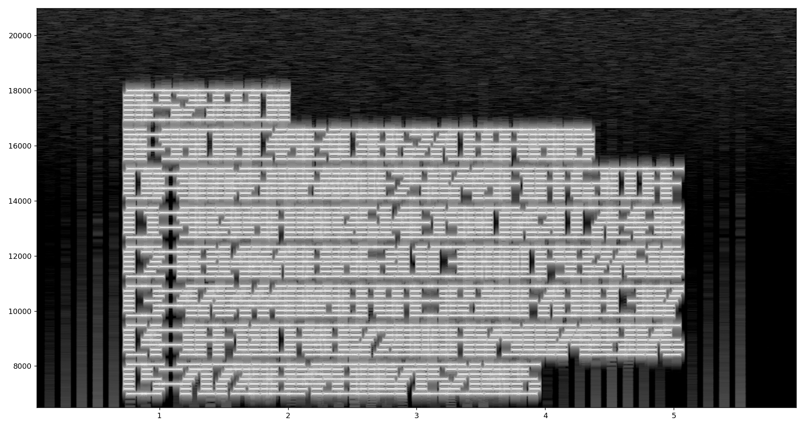
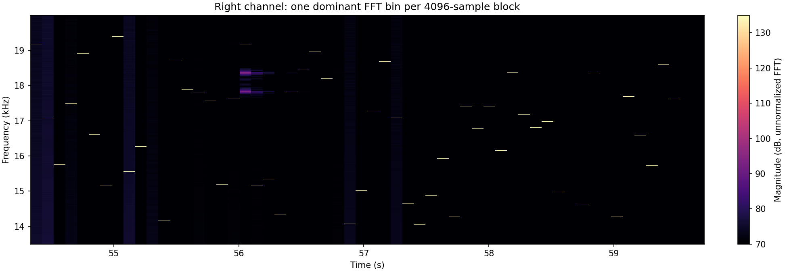

# No Bit Sings Alone

## Challenge

The WAV contains two linked steganographic layers. Text in the opening spectrogram provides an AES-256-GCM nonce and ciphertext. Near the end, tones in the right channel identify FFT bins that control a modular walk through samples in the left channel. Each block yields a 5-bit Hamming syndrome after applying a frequency-dependent rotation of the parity-check columns. The resulting stream contains 32 nine-bit values in GF(257). An inverse 32-point number-theoretic transform (NTT) reconstructs the AES key, and the GCM tag verifies successfully.

```text
Right-channel FFT bins
    -> modular sample positions in the left channel
    -> rotated Hamming parity-check columns
    -> 58 five-bit syndromes
    -> 32 nine-bit GF(257) values + 2 padding bits
    -> inverse NTT
    -> AES-256 key
    -> authenticated flag
```

## Analysis

The challenge, by Hidden Investigations, supplies `no-bit-sings-alone.zip` with a single `suspicious.wav`. Its description asks us to listen carefully and look deeper. The supplied hint explains the dependency between the channels: the visible signal controls sample selection in the opposite channel, frequency information also arranges parity relationships, and the recovered symbols require a reversible finite-field transform.

The WAV is ordinary stereo PCM:

| Property | Value |
|---|---|
| Sample rate | 44,100 Hz |
| Sample format | Signed 16-bit, little-endian |
| Channels | 2 |
| Frames | 2,635,988 |
| Duration | Approximately 59.773 seconds |
| WAV SHA-256 | `fc3d9d08017073b22d65fee816a62795bc760e1529fe914dd5e20c081186ed96` |

There are no additional RIFF chunks or appended payload bytes. Direct LSB extraction did not produce a validated payload. The useful carrier is a selected set of LSBs whose parity relationships depend on the other channel.

## Solution

### 1. Read the AES metadata from the opening spectrogram

The beginning of the left channel contains high-frequency raster text. Viewing approximately the first six seconds as a spectrogram reveals the algorithm label, nonce, and six ciphertext fragments.



The transcription is:

```text
AES256GCM
N=99CB9C49E4C83527CE6F89D9
C0=8A845BA500DE25B749F1FF63CCFF
C1=9D2D9FD8D2614E19BCA42CC7E438
C2=B31407AE896311C3AADCF9327610
C3=478444A09EF6FE3650DF7EBEC3B7
C4=1FF18CF0EB728DBFA791B7485D76
C5=7172AE8493A8715210B5
```

`N` is a 12-byte nonce. Concatenating `C0` through `C5` gives 80 bytes. The successful decryption uses the last 16 bytes as the GCM authentication tag, leaving 64 bytes of ciphertext, with empty associated data. Successful tag verification also validates the transcription for this decryption.

### 2. Use the right-channel FFT bins as modular strides

The tail contains 58 consecutive tone blocks, each 4096 frames long. Their alignment is to the beginning of the PCM data: they occupy blocks **585 through 642**, using zero-based block numbering.

```text
First frame: 585 * 4096 = 2,396,160
Start time:  2,396,160 / 44,100 = approximately 54.334 seconds
End frame:   643 * 4096 = 2,633,728 (exclusive)
```



For each block, compute the real FFT of the right channel and select the strongest bin in the high-frequency band. The solve script searches bins 1200 through 1899. The first bins are:

```text
1781, 1583, 1463, 1625, 1757, 1543, 1409, 1801, ...
```

The FFT bin is the integer index for a **4096-point FFT**, rather than the frequency rounded to hertz. All 58 bins are odd. Therefore each bin `b` is coprime to 4096, making it a valid stride for a modular walk that does not repeat a position before traversing the block.

For each block, select 31 left-channel samples at these positions:

```python
positions = [((j + 1) * b) % 4096 for j in range(31)]
bits = [left_block[p] & 1 for p in positions]
```

Positions are relative to the current block. The first position is `b % 4096`, not position zero.

### 3. Recover five bits per block with shifted Hamming columns

The 31 selected LSBs do not represent 31 consecutive message bits. They contribute to a 5-bit syndrome, using the nonzero five-bit column labels `1..31` of a Hamming parity-check matrix.

The same FFT bin determines a cyclic shift of those labels. For selected bit index `j = 0..30`, the label is:

```python
column = ((j - b) % 31) + 1
```

This is equivalent to rotating the list `1..31` to the right by `b % 31`. XOR the labels corresponding to selected bits that are one:

```python
syndrome = 0
for j, bit in enumerate(bits):
    if bit:
        syndrome ^= ((j - b) % 31) + 1
```

The syndrome lies in `0..31`, so it carries five message bits. No Hamming error-correction step is needed: the syndrome itself is the embedded value.

Serialize all 58 syndromes in block order, each as five bits with the most significant bit first. This gives:

```text
58 * 5 = 290 bits
```

### 4. Interpret the stream as nine-bit finite-field values

The final two bits are zero padding. The first 288 bits split into 32 nine-bit integers, again with the most significant bit first:

```text
205 208 154 114 115 240 123 108
245 172  73 192 256 177  62 202
153   7  77 138 175   0   4  68
208  32  76 169 103  36 147 216
```

Every value is in `0..256`, and one is exactly 256. This makes GF(257) the natural field for the next layer. Reading these values as ordinary bytes would lose information.

The length also fits the key reconstruction: 32 field elements can transform into 32 AES key bytes. The finite-field transform hypothesis is confirmed by the authenticated decryption in the final step.

### 5. Invert the NTT to reconstruct the AES key

Use a 32-point NTT modulo the prime 257. A suitable primitive 32nd root of unity is:

```text
omega = 3^8 mod 257 = 136
omega^32 mod 257 = 1
omega^16 mod 257 = 256
32^(-1) mod 257 = 249
```

If the extracted values are `Y[k]`, the inverse transform is:

```text
K[j] = 249 * sum(Y[k] * 136^(-j*k), k=0..31) mod 257
```

All 32 reconstructed values are valid bytes. In hexadecimal, the AES-256 key is:

```text
8da8dca0aa79a8a2b1e1aef181e98e63fcca7da26d49d6dbffdb461e3ecd544d
```

Applying the forward NTT to these key bytes reproduces all 32 extracted field elements. The script checks this before attempting AES-GCM decryption.

### 6. Authenticate the ciphertext and extract the flag

Decrypt using the recovered key, the spectrogram nonce, and the last 16 concatenated ciphertext bytes as the tag:

```python
plaintext = AES.new(key, AES.MODE_GCM, nonce=nonce).decrypt_and_verify(
    sealed[:-16], sealed[-16:]
)
```

Tag verification succeeds with empty associated data. The authenticated plaintext is 64 bytes long:

| Offset | Length | Content |
|---|---|---|
| 0 | 2 bytes | `00 32`, a big-endian length of 50 |
| 2 | 50 bytes | The flag |
| 52 | 12 bytes | Trailing binary data |

The length prefix isolates the flag without treating the trailing bytes as text.

## Reproduce

The script below accepts either the original challenge ZIP or `suspicious.wav`. The spectrogram text is transcribed into constants; FFT extraction, modular sample selection, syndrome recovery, finite-field decoding, the inverse transform, and GCM verification are performed by the script.

Install the two dependencies and run:

```bash
python -m pip install numpy pycryptodome
python assets/no-bit-sings-alone/solve.py /path/to/no-bit-sings-alone.zip
# Or supply the extracted WAV:
python assets/no-bit-sings-alone/solve.py /path/to/suspicious.wav
```

[Download the standalone solve script](https://github.com/tinhatinh/CTFWU/blob/main/HI%20Cyber%20Con%202026%20CTF/assets/no-bit-sings-alone/solve.py).

```python
#!/usr/bin/env python3
"""Recover the flag from suspicious.wav or its ZIP. Requires numpy, pycryptodome."""
import argparse
import hashlib
import io
import re
import wave
import zipfile
from pathlib import Path

import numpy as np
from Crypto.Cipher import AES

# Transcribed from the introductory spectrogram; see the existing analysis.
NONCE = bytes.fromhex('99CB9C49E4C83527CE6F89D9')
SEALED = bytes.fromhex(
    '8A845BA500DE25B749F1FF63CCFF'
    '9D2D9FD8D2614E19BCA42CC7E438'
    'B31407AE896311C3AADCF9327610'
    '478444A09EF6FE3650DF7EBEC3B7'
    '1FF18CF0EB728DBFA791B7485D76'
    '7172AE8493A8715210B5'
)


def load_wav(path):
    data = Path(path).read_bytes()
    if zipfile.is_zipfile(io.BytesIO(data)):
        with zipfile.ZipFile(io.BytesIO(data)) as archive:
            names = [n for n in archive.namelist() if n.lower().endswith('.wav')]
            if len(names) != 1:
                raise ValueError('Provide the original challenge ZIP or suspicious.wav')
            data = archive.read(names[0])
    with wave.open(io.BytesIO(data)) as audio:
        assert (audio.getnchannels(), audio.getsampwidth(), audio.getframerate()) == (2, 2, 44100)
        samples = np.frombuffer(audio.readframes(audio.getnframes()), dtype='<i2').reshape(-1, 2)
    return data, samples


def solve(path):
    wav, samples = load_wav(path)
    block_size, first_block, count = 4096, 585, 58
    blocks = samples[first_block * block_size:(first_block + count) * block_size]
    blocks = blocks.reshape(count, block_size, 2)
    spectrum = np.abs(np.fft.rfft(blocks[:, :, 1], axis=1))
    bins = spectrum[:, 1200:1900].argmax(axis=1) + 1200
    assert np.all(bins & 1)  # Each stride is coprime to 4096.

    # The right-channel FFT bin controls the walk in the left channel.
    j = np.arange(31)[None, :]
    positions = ((j + 1) * bins[:, None]) % block_size
    selected = blocks[np.arange(count)[:, None], positions, 0] & 1

    # Hamming parity-check columns, cyclically shifted by the bin index.
    columns = ((j - bins[:, None]) % 31) + 1
    syndromes = np.bitwise_xor.reduce(selected * columns, axis=1)
    bits = ((syndromes[:, None] >> np.arange(4, -1, -1)) & 1).ravel()
    assert np.all(bits[288:] == 0)
    values = (bits[:288].reshape(32, 9) @ (1 << np.arange(8, -1, -1))).tolist()
    assert all(0 <= v < 257 for v in values)

    # Inverse 32-point NTT in GF(257), primitive root 136 = 3**8 mod 257.
    modulus, n, root = 257, 32, 136
    assert pow(root, n, modulus) == 1 and pow(root, n // 2, modulus) != 1
    key_values = [
        sum(v * pow(root, (-j * k) % n, modulus) for k, v in enumerate(values))
        * pow(n, -1, modulus) % modulus
        for j in range(n)
    ]
    key = bytes(key_values)
    # Independent consistency check of the forward transform.
    assert values == [
        sum(v * pow(root, (j * k) % n, modulus) for j, v in enumerate(key)) % modulus
        for k in range(n)
    ]
    plaintext = AES.new(key, AES.MODE_GCM, nonce=NONCE).decrypt_and_verify(SEALED[:-16], SEALED[-16:])
    # Authenticated plaintext is a big-endian length, flag, then trailing data.
    length = int.from_bytes(plaintext[:2], 'big')
    flag = plaintext[2:2 + length]
    assert re.fullmatch(rb'hiCTF\{[^}]+\}', flag)
    print('WAV SHA-256:', hashlib.sha256(wav).hexdigest())
    print('FFT bins:', bins.tolist())
    print('GF(257) values:', values)
    print('AES key:', key.hex())
    print('AES-GCM tag: VERIFIED')
    print('Flag:', flag.decode('ascii'))
    return flag.decode('ascii')


if __name__ == '__main__':
    parser = argparse.ArgumentParser(description=__doc__)
    parser.add_argument('input', help='suspicious.wav or original no-bit-sings-alone.zip')
    solve(parser.parse_args().input)
```

The solver was run against the preserved original challenge ZIP. Its final output includes:

```text
AES key: 8da8dca0aa79a8a2b1e1aef181e98e63fcca7da26d49d6dbffdb461e3ecd544d
AES-GCM tag: VERIFIED
Flag: hiCTF{m4th3m4t!c5_g4v3_m3_4_l0t_Of_p4!n_8d52ae513}
```

## Result

```text
hiCTF{m4th3m4t!c5_g4v3_m3_4_l0t_Of_p4!n_8d52ae513}
```
