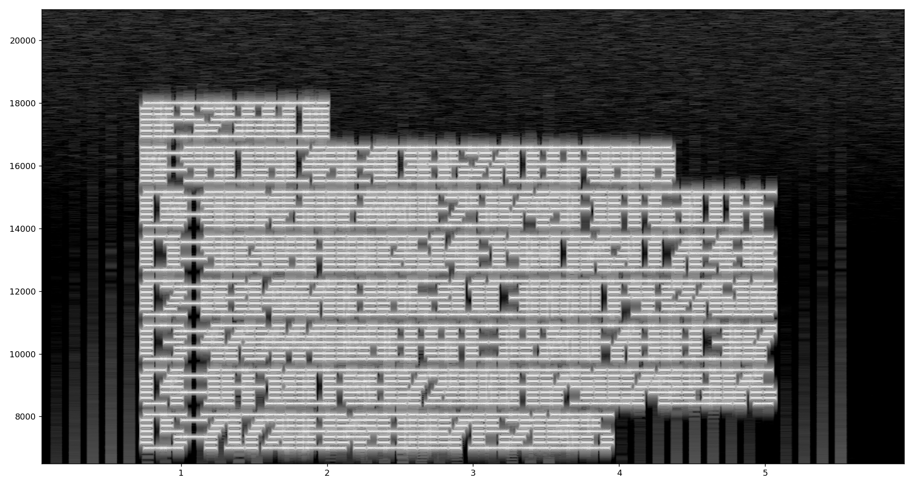
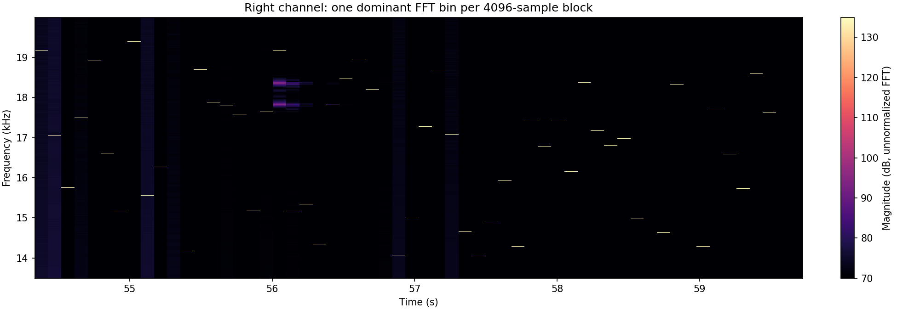

# No Bit Sings Alone

## Đề bài

Archive `no-bit-sings-alone.zip` của Hidden Investigations chứa một file `suspicious.wav`. Đề gợi ý phải nghe kỹ và nhìn sâu hơn; hint cho biết tín hiệu nhìn thấy ở một kênh quyết định cách chọn sample bên kênh còn lại, tần số cũng điều khiển quan hệ parity, và các symbol thu được còn qua một phép biến đổi khả nghịch trên trường hữu hạn.

Lời giải nối hai lớp giấu tin: spectrogram đầu file cho nonce/ciphertext AES-256-GCM; các tone cuối kênh phải điều khiển đường đi trên LSB kênh trái. Syndrome Hamming tạo một luồng phần tử GF(257); inverse NTT khôi phục khóa AES.

```text
Right-channel FFT bins
    -> modular sample positions in the left channel
    -> rotated Hamming parity-check columns
    -> 58 five-bit syndromes
    -> 32 nine-bit GF(257) values + 2 padding bits
    -> inverse NTT
    -> AES-256 key
    -> authenticated flag
```

## Phân tích

WAV là PCM stereo thông thường:

| Thuộc tính | Giá trị |
|---|---|
| Sample rate | 44.100 Hz |
| Định dạng sample | Signed 16-bit, little-endian |
| Số kênh | 2 |
| Số frame | 2.635.988 |
| Thời lượng | Khoảng 59,773 giây |
| SHA-256 WAV | `fc3d9d08017073b22d65fee816a62795bc760e1529fe914dd5e20c081186ed96` |

Không có RIFF chunk bổ sung hay payload nối sau file. Trích LSB liên tiếp không cho một payload được xác thực. Dữ liệu nằm ở tập LSB được chọn theo tín hiệu kênh đối diện, với quan hệ parity thay đổi theo tần số.

## Lời giải

### 1. Đọc metadata AES từ spectrogram đầu file

Khoảng sáu giây đầu kênh trái có chữ raster ở dải tần cao. Spectrogram cho tên thuật toán, nonce và sáu đoạn ciphertext:



```text
AES256GCM
N=99CB9C49E4C83527CE6F89D9
C0=8A845BA500DE25B749F1FF63CCFF
C1=9D2D9FD8D2614E19BCA42CC7E438
C2=B31407AE896311C3AADCF9327610
C3=478444A09EF6FE3650DF7EBEC3B7
C4=1FF18CF0EB728DBFA791B7485D76
C5=7172AE8493A8715210B5
```

`N` dài 12 byte. Ghép `C0` đến `C5` thu 80 byte: 64 byte ciphertext và 16 byte authentication tag ở cuối. AAD rỗng. Tag GCM được kiểm tra thành công ở bước cuối, đồng thời xác nhận cách chép các ký tự từ spectrogram.

### 2. Lấy FFT bin làm bước nhảy modulo

Cuối file có 58 tone block liên tiếp, mỗi block 4096 frame. Lưới block căn từ đầu dữ liệu PCM; các block mang tín hiệu có chỉ số **585 đến 642**, đánh số từ 0:

```text
First frame: 585 * 4096 = 2,396,160
Start time:  2,396,160 / 44,100 = approximately 54.334 seconds
End frame:   643 * 4096 = 2,633,728 (exclusive)
```



Với mỗi block, tính real FFT của kênh phải và chọn bin mạnh nhất trong dải 1200..1899. Các bin đầu:

```text
1781, 1583, 1463, 1625, 1757, 1543, 1409, 1801, ...
```

Đây là **chỉ số bin của FFT 4096 điểm**, không phải tần số Hz làm tròn. Cả 58 bin đều lẻ, nên mỗi bin `b` nguyên tố cùng nhau với 4096. Dùng `b` làm stride modulo 4096 sẽ không lặp vị trí trước khi đi hết block.

Chọn 31 sample kênh trái tại các vị trí:

```python
positions = [((j + 1) * b) % 4096 for j in range(31)]
bits = [left_block[p] & 1 for p in positions]
```

Các vị trí tính tương đối với block hiện tại. Vị trí đầu tiên là `b % 4096`, không phải 0.

### 3. Thu năm bit bằng syndrome Hamming

31 LSB được chọn không phải 31 bit thông điệp liên tiếp. Chúng đóng góp vào syndrome năm bit theo 31 cột khác 0 của ma trận kiểm tra parity Hamming.

FFT bin còn quyết định độ xoay nhãn cột. Với bit thứ `j=0..30`:

```python
column = ((j - b) % 31) + 1
```

Công thức tương đương xoay danh sách `1..31` sang phải `b % 31` vị trí. XOR các nhãn ứng với bit bằng 1:

```python
syndrome = 0
for j, bit in enumerate(bits):
    if bit:
        syndrome ^= ((j - b) % 31) + 1
```

Syndrome thuộc `0..31`, mang năm bit dữ liệu. Không cần chạy bước sửa lỗi Hamming: chính syndrome là giá trị được nhúng. Ghép 58 syndrome theo thứ tự block, mỗi giá trị năm bit từ bit cao xuống bit thấp:

```text
58 * 5 = 290 bits
```

### 4. Tách các phần tử GF(257)

Hai bit cuối là padding 0. Chia 288 bit còn lại thành 32 số chín bit, tiếp tục đọc MSB trước:

```text
205 208 154 114 115 240 123 108
245 172  73 192 256 177  62 202
153   7  77 138 175   0   4  68
208  32  76 169 103  36 147 216
```

Mọi giá trị đều nằm trong `0..256`, có một giá trị đúng bằng 256. Vì vậy không được ép ngay thành byte; GF(257) giữ được toàn bộ miền giá trị này. Số lượng 32 phần tử cũng phù hợp với việc khôi phục khóa AES-256 dài 32 byte.

### 5. Đảo NTT để lấy khóa

Dùng NTT 32 điểm modulo số nguyên tố 257. Một căn nguyên thủy bậc 32 phù hợp là 136:

```text
omega = 3^8 mod 257 = 136
omega^32 mod 257 = 1
omega^16 mod 257 = 256
32^(-1) mod 257 = 249
```

Gọi dữ liệu trích ra là `Y[k]`. Phép biến đổi ngược:

```text
K[j] = 249 * sum(Y[k] * 136^(-j*k), k=0..31) mod 257
```

32 giá trị khôi phục đều nằm trong miền byte. Khóa AES ở dạng hex:

```text
8da8dca0aa79a8a2b1e1aef181e98e63fcca7da26d49d6dbffdb461e3ecd544d
```

Áp dụng forward NTT lên các byte khóa tái tạo đúng cả 32 phần tử ban đầu. Script kiểm tra đối chứng này trước khi giải AES-GCM.

### 6. Xác thực và tách flag

Giải mã bằng khóa vừa tìm, nonce từ spectrogram và 16 byte cuối làm tag:

```python
plaintext = AES.new(key, AES.MODE_GCM, nonce=nonce).decrypt_and_verify(
    sealed[:-16], sealed[-16:]
)
```

Tag hợp lệ với AAD rỗng. Plaintext đã xác thực dài 64 byte:

| Offset | Độ dài | Nội dung |
|---|---|---|
| 0 | 2 byte | `00 32`, độ dài 50 ở dạng big-endian |
| 2 | 50 byte | Flag |
| 52 | 12 byte | Dữ liệu nhị phân cuối |

Đọc length prefix để lấy đúng flag, không coi các byte cuối là văn bản.

## Tái hiện

Script nhận ZIP gốc hoặc `suspicious.wav`. Chữ trên spectrogram được chép vào hằng số; script tự làm FFT, chọn sample modulo, tính syndrome, giải các phần tử trường hữu hạn, inverse NTT và kiểm tra tag GCM.

Cài `numpy`, `pycryptodome` rồi chạy:

```bash
python -m pip install numpy pycryptodome
python assets/no-bit-sings-alone/solve.py /path/to/no-bit-sings-alone.zip
# Or supply the extracted WAV:
python assets/no-bit-sings-alone/solve.py /path/to/suspicious.wav
```

[Tải script độc lập](https://github.com/tinhatinh/CTFWU/blob/main/HI%20Cyber%20Con%202026%20CTF/assets/no-bit-sings-alone/solve.py). Toàn bộ code cũng nằm ngay dưới đây để có thể lưu thành `solve.py` và truyền đường dẫn artifact qua đối số dòng lệnh.

```python
#!/usr/bin/env python3
"""Recover the flag from suspicious.wav or its ZIP. Requires numpy, pycryptodome."""
import argparse
import hashlib
import io
import re
import wave
import zipfile
from pathlib import Path

import numpy as np
from Crypto.Cipher import AES

# Transcribed from the introductory spectrogram; see the existing analysis.
NONCE = bytes.fromhex('99CB9C49E4C83527CE6F89D9')
SEALED = bytes.fromhex(
    '8A845BA500DE25B749F1FF63CCFF'
    '9D2D9FD8D2614E19BCA42CC7E438'
    'B31407AE896311C3AADCF9327610'
    '478444A09EF6FE3650DF7EBEC3B7'
    '1FF18CF0EB728DBFA791B7485D76'
    '7172AE8493A8715210B5'
)


def load_wav(path):
    data = Path(path).read_bytes()
    if zipfile.is_zipfile(io.BytesIO(data)):
        with zipfile.ZipFile(io.BytesIO(data)) as archive:
            names = [n for n in archive.namelist() if n.lower().endswith('.wav')]
            if len(names) != 1:
                raise ValueError('Provide the original challenge ZIP or suspicious.wav')
            data = archive.read(names[0])
    with wave.open(io.BytesIO(data)) as audio:
        assert (audio.getnchannels(), audio.getsampwidth(), audio.getframerate()) == (2, 2, 44100)
        samples = np.frombuffer(audio.readframes(audio.getnframes()), dtype='<i2').reshape(-1, 2)
    return data, samples


def solve(path):
    wav, samples = load_wav(path)
    block_size, first_block, count = 4096, 585, 58
    blocks = samples[first_block * block_size:(first_block + count) * block_size]
    blocks = blocks.reshape(count, block_size, 2)
    spectrum = np.abs(np.fft.rfft(blocks[:, :, 1], axis=1))
    bins = spectrum[:, 1200:1900].argmax(axis=1) + 1200
    assert np.all(bins & 1)  # Each stride is coprime to 4096.

    # The right-channel FFT bin controls the walk in the left channel.
    j = np.arange(31)[None, :]
    positions = ((j + 1) * bins[:, None]) % block_size
    selected = blocks[np.arange(count)[:, None], positions, 0] & 1

    # Hamming parity-check columns, cyclically shifted by the bin index.
    columns = ((j - bins[:, None]) % 31) + 1
    syndromes = np.bitwise_xor.reduce(selected * columns, axis=1)
    bits = ((syndromes[:, None] >> np.arange(4, -1, -1)) & 1).ravel()
    assert np.all(bits[288:] == 0)
    values = (bits[:288].reshape(32, 9) @ (1 << np.arange(8, -1, -1))).tolist()
    assert all(0 <= v < 257 for v in values)

    # Inverse 32-point NTT in GF(257), primitive root 136 = 3**8 mod 257.
    modulus, n, root = 257, 32, 136
    assert pow(root, n, modulus) == 1 and pow(root, n // 2, modulus) != 1
    key_values = [
        sum(v * pow(root, (-j * k) % n, modulus) for k, v in enumerate(values))
        * pow(n, -1, modulus) % modulus
        for j in range(n)
    ]
    key = bytes(key_values)
    # Independent consistency check of the forward transform.
    assert values == [
        sum(v * pow(root, (j * k) % n, modulus) for j, v in enumerate(key)) % modulus
        for k in range(n)
    ]
    plaintext = AES.new(key, AES.MODE_GCM, nonce=NONCE).decrypt_and_verify(SEALED[:-16], SEALED[-16:])
    # Authenticated plaintext is a big-endian length, flag, then trailing data.
    length = int.from_bytes(plaintext[:2], 'big')
    flag = plaintext[2:2 + length]
    assert re.fullmatch(rb'hiCTF\{[^}]+\}', flag)
    print('WAV SHA-256:', hashlib.sha256(wav).hexdigest())
    print('FFT bins:', bins.tolist())
    print('GF(257) values:', values)
    print('AES key:', key.hex())
    print('AES-GCM tag: VERIFIED')
    print('Flag:', flag.decode('ascii'))
    return flag.decode('ascii')


if __name__ == '__main__':
    parser = argparse.ArgumentParser(description=__doc__)
    parser.add_argument('input', help='suspicious.wav or original no-bit-sings-alone.zip')
    solve(parser.parse_args().input)
```

Output cuối được giữ trong bản ghi của lần chạy trên ZIP gốc:

```text
AES key: 8da8dca0aa79a8a2b1e1aef181e98e63fcca7da26d49d6dbffdb461e3ecd544d
AES-GCM tag: VERIFIED
Flag: hiCTF{m4th3m4t!c5_g4v3_m3_4_l0t_Of_p4!n_8d52ae513}
```

## Kết quả

```text
hiCTF{m4th3m4t!c5_g4v3_m3_4_l0t_Of_p4!n_8d52ae513}
```
